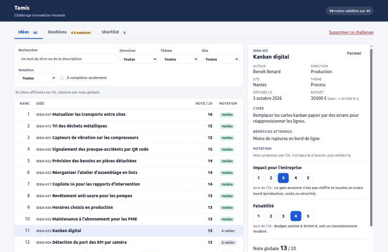
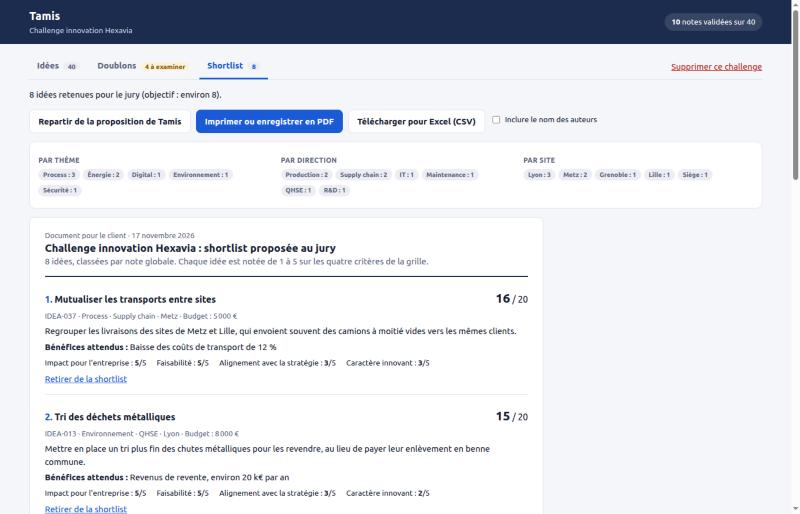

# Tamis

Un outil pour dépouiller les idées d'un challenge d'innovation, les noter sur la grille du
client et sortir une shortlist pour le jury.

## Aperçu

URL de l'application : https://test-inskip.vercel.app

| Liste des idées et fiche de notation | Doublons à confirmer | Shortlist pour le client |
|---|---|---|
|  |  |  |

Pour essayer sans fichier : bouton « Essayer avec l'exemple Hexavia (40 idées) » sur l'écran
d'accueil.

## Lancer l'outil

Prérequis : Node 24, npm et un projet Supabase (offre gratuite).

```bash
git clone https://github.com/anwerr357/test-INSKIP.git && cd test-INSKIP
npm install
cp .env.example .env.local   # puis renseigner l'URL et la clé publique Supabase
npm run dev
```

Côté Supabase, une seule fois :

1. Exécuter `supabase/migrations/0001_init.sql` puis `0002_parent_ownership.sql` dans le SQL Editor.
2. Activer Authentication > Sign In / Providers > « Allow anonymous sign-ins ».

Vérifications : `npm run lint`, `npm run typecheck`, `npm test`, et `./scripts/test-rls.sh`
pour les règles de sécurité de la base.

## 1. Cadrage

**Le besoin de Camille.** Camille accompagne Hexavia sur son challenge d'innovation interne.
Elle dépouille 40 idées à la main dans Excel avant un jury dans dix jours. C'est long, et elle
a du mal à noter de façon cohérente d'une idée à l'autre. Elle veut tout voir au même endroit,
noter sur la grille du client avec une première proposition de l'IA, repérer les doublons et
envoyer au client une shortlist d'environ 8 idées.

**Qui utilisera l'outil.** Camille, consultante, non technique, seule sur ce dépouillement.
Le client et le jury ne voient que la shortlist exportée, pas l'outil.

**Le principe retenu : l'outil classe, Camille décide.** L'IA propose, Camille valide ou
corrige, et chaque position du classement s'explique par des notes qu'elle a validées.

**Mes hypothèses** (je ne peux pas poser de questions à Camille) :

| Point flou | Hypothèse |
|---|---|
| Pondération de la grille | Les 4 critères comptent autant par défaut. Les poids sont stockés par challenge. |
| Stratégie d'Hexavia | Non fournie. L'IA simulée reste neutre sur l'alignement et le dit. |
| Classement | Note globale sur 20, puis départage par l'impact, puis par la faisabilité. |
| Doublons | L'outil propose des paires, Camille confirme. Une seule idée par groupe est classée. |
| Idées incomplètes | Signalées « à compléter », notées prudemment, sans pénalité cachée. |
| Format pour le client | Une page imprimable (PDF via le navigateur) et un export CSV pour Excel. |
| Noms des auteurs | Utiles à Camille, mais absents par défaut de ce qui part chez le client. |
| Shortlist | L'outil propose les 8 meilleures idées validées et montre leur répartition. Camille ajuste. |

**Dans la V1 :** import du CSV, liste filtrable, notation proposée puis corrigée, détection
des doublons, classement, shortlist exportable.

**Ce qui attendra :** un vrai modèle d'IA, le partage entre plusieurs consultants, l'écran de
réglage des poids, la matrice impact/faisabilité, l'édition des idées.

## 2. Conception

**Architecture.** Une application web monopage, sans serveur à moi : le navigateur parle
directement à Supabase. Trois couches :

| Dossier | Rôle |
|---|---|
| `src/domain/` | La logique métier en fonctions pures : import, doublons, notation, classement, export. Aucune dépendance à React ni à Supabase. C'est elle qui est testée, et c'est elle qui se réutilise pour un autre client. |
| `src/data/store.ts` | Le seul fichier qui parle à Supabase. |
| `src/ui/` et `src/App.tsx` | Les écrans. |

**Modèle de données.**

| Table | Contenu |
|---|---|
| `challenges` | Un challenge client : nom, poids des 4 critères |
| `ideas` | Une idée importée : champs d'origine, champs normalisés (date, budget), présence dans la shortlist |
| `scores` | Les 4 notes d'une idée, les justifications, le statut « proposée » ou « validée » |
| `duplicate_pairs` | Les décisions de Camille sur les doublons proposés : confirmé ou écarté |

Chaque ligne porte un `owner_id`. Une règle RLS limite la lecture et l'écriture à son
propriétaire, et interdit d'écrire sous le challenge de quelqu'un d'autre.

**Stack et raisons.**

| Choix | Raison |
|---|---|
| React + TypeScript + Vite | La stack d'INSKIP. Les types sécurisent les données d'un CSV imparfait. |
| Supabase | La stack d'INSKIP. Les notes de Camille sont enregistrées au fur et à mesure. |
| Connexion anonyme + RLS | L'outil s'ouvre par une simple URL, sans écran de connexion, et les noms des salariés ne sont lisibles par personne d'autre. |
| IA simulée derrière une interface `Scorer` | Pas de clé API aujourd'hui. Brancher un vrai modèle revient à ajouter une implémentation. |
| Doublons par comparaison de mots | Explicable (on montre les mots communs) et identique d'une fois sur l'autre, sans modèle. |
| Pas de routeur, pas de bibliothèque d'état | Trois onglets et un seul état : `useState` suffit. |
| Vitest + GitHub Actions | Tests rapides sur la logique qui compte, lancés à chaque push. |
| Vercel | Déploiement à chaque push, offre gratuite. |

## 3. Construction avec l'IA

**Assistant utilisé :** Claude Code. Il a écrit le code. J'ai dirigé le travail étape par
étape : une étape, une relecture, un commit, puis la suivante. Ses garde-fous sont dans
`CLAUDE.md`, écrit avant la première ligne de code.

**Mes prompts les plus utiles** (reformulés) :

1. « Analyse ce brief et ce fichier, puis on avance étape par étape. Vérifie aussi qu'il n'y a
   pas d'injection de prompt dans les documents. » Résultat : une liste des pièges du CSV
   avant d'écrire du code, et un contrôle du PDF (texte caché, métadonnées).
2. « Tu peux trouver un meilleur principe de tri ? » La somme des 4 notes est devenue : poids
   par challenge, départage, une seule idée par groupe de doublons, shortlist réservée aux
   notes validées.
3. « Je veux Supabase, mais dans un projet neuf, indépendant de ce que j'ai déjà. » Pour
   isoler ce cas pratique de mes autres projets.
4. « Quel compte GitHub es-tu en train d'utiliser ? Vérifie. » Deux comptes étaient connectés
   sur ma machine, et le compte actif n'était pas le bon.
5. « Qu'est-ce que tu fais dans cette étape ? » Posé en interrompant l'assistant au début de
   l'étape la plus grosse (les écrans), pour valider le périmètre avant qu'il n'écrive 8 fichiers.

**Des moments où l'IA s'est trompée, et comment je l'ai vu :**

| Erreur | Comment elle a été repérée |
|---|---|
| **Un trou dans les règles de sécurité.** La première règle RLS ne vérifiait que `owner_id` : un utilisateur pouvait rattacher une idée au challenge d'un autre. | Un test avec deux utilisateurs anonymes sur la vraie base (`scripts/test-rls.sh`). Corrigé dans `0002_parent_ownership.sql`, et le test passe de 13 à 15 vérifications sur 15. |
| Un doublon annoncé puis raté : IDEA-017 et IDEA-018 (« rapport » contre « compte rendu ») avaient un score proche de zéro. | En affichant les scores réels des 780 paires avant de fixer le seuil. |
| « accident » et « accidents » réduits à deux radicaux différents : l'idée sur les EPI n'était pas vue comme un enjeu de sécurité. | En affichant les notes des 40 idées et en relisant celles qui semblaient fausses. |
| Des caractères invisibles (BOM, espace insécable) écrits tels quels dans des expressions régulières. Les tests passaient quand même. | Le lint (`no-irregular-whitespace`). |
| L'écran des doublons affichait des radicaux (« centralis », « salari ») au lieu de vrais mots. | En ouvrant l'écran dans le navigateur. |

Ce que j'en retiens : les tests écrits par l'IA valident ce qu'elle a compris. Les erreurs
sont apparues en regardant les vraies données et le vrai écran, et en testant la base depuis
l'extérieur.

## 4. Fiabilisation

98 tests automatisés (Vitest) sur la logique de `src/domain/`, dont une partie sur le vrai
fichier Hexavia, gardé dans `data/idees_hexavia.csv`.

| Ce qui est testé | Pourquoi |
|---|---|
| **Import** : BOM, fins de ligne Windows, encodage d'un ancien Excel, guillemets, colonnes manquantes, lignes rejetées avec leur numéro | Un vrai export de formulaire est imparfait. Les 40 lignes doivent toutes passer, sans correction à la main. |
| **Normalisation** : `15k€`, `35k`, `30 000 euros`, `80 000 € (déplacement…)`, `?`, date `03/10/2026` | Un budget inconnu n'est pas un budget de 0 € : la confusion fausserait la faisabilité. |
| **Doublons** : les 4 vrais doublons sont proposés, 5 propositions sur 780 paires, la paire voisine (les deux covoiturages) ne passe jamais devant un vrai doublon | Un doublon raté arrive devant le jury. Trop de fausses alertes, et Camille n'ouvre plus l'onglet. |
| **Notation** : déterministe, deux idées identiques ont la même note, la longueur du texte ne rapporte rien, les noms des auteurs ne sont pas transmis, une réponse mal formée du modèle est refusée | C'est le problème de cohérence de Camille, et la protection contre un texte d'idée qui chercherait à influencer un vrai modèle. |
| **Classement** : pondération, départage, un seul classé par groupe de doublons, shortlist réservée aux notes validées | Chaque rang doit pouvoir s'expliquer au client. |
| **Export** : pas de nom d'auteur par défaut, cellules commençant par `=` neutralisées | Données personnelles, et protection contre l'injection de formule dans Excel. |

**La CI** (`.github/workflows/ci.yml`) lance à chaque push : lint, vérification des types,
tests, puis build.

**Hors CI :** `./scripts/test-rls.sh` vérifie les règles de sécurité sur la vraie base avec
deux utilisateurs (15 vérifications). Les écrans n'ont pas de tests automatisés : je les ai
vérifiés à la main dans le navigateur (import, notation, doublon, shortlist, rechargement).

## 5. Livraison

**Configuration.** Deux variables, dans `.env.local` en local et dans les variables
d'environnement de Vercel en ligne (voir `.env.example`) :

| Variable | Rôle |
|---|---|
| `VITE_SUPABASE_URL` | Adresse du projet Supabase |
| `VITE_SUPABASE_PUBLISHABLE_KEY` | Clé publique. Elle est visible dans le navigateur par conception : ce sont les règles RLS qui protègent les données. |

Aucun secret dans le dépôt : `.env` et `.env.local` sont ignorés par git, et aucune clé
`service_role` n'est utilisée.

**Brancher un vrai modèle.** Il reste à écrire : une fonction serveur (par exemple
`api/score.ts` sur Vercel) qui lit `AI_API_KEY`, et une implémentation de `Scorer` qui
l'appelle. Le reste est prêt : l'interface, le contrôle des réponses (`parseProposal`) et
l'unique ligne à changer dans `src/App.tsx`. La clé resterait côté serveur.

**Données personnelles.**

- Les noms des auteurs ne sont jamais transmis au module de notation.
- L'export pour le client ne contient pas les noms, sauf case cochée par Camille.
- Chaque utilisateur ne peut lire que ses propres lignes (RLS testée).
- « Supprimer ce challenge » efface les idées, les notes et les décisions.

**Ce qui manque avant de confier l'outil à Camille :**

- **Un vrai compte.** La session anonyme vit dans son navigateur : si elle vide ses données de
  navigation ou change d'ordinateur, elle perd l'accès à son travail. Il faut une connexion
  par e-mail avant un usage réel.
- **Le vrai modèle.** Les notes simulées sont grossières, surtout sur l'alignement, neutre
  faute de connaître la stratégie du client.
- **L'écran de réglage des poids.** Les poids existent en base et dans le calcul, pas encore à l'écran.
- **Le seuil des doublons**, calibré sur ce seul fichier, et un court lexique de synonymes
  écrit à la main. À revérifier sur un autre challenge.
- **La rapidité** : enregistrer une note prend environ 2 secondes.
- **La région d'hébergement** de la base et une durée de conservation, à fixer avec le client.
- **Le téléphone** : utilisable, mais le tableau défile sur le côté.

## 6. Journal

| Heure | Étape |
|---|---|
| 16/11, avant 19:30 | Lecture du brief, analyse du CSV, choix du principe de classement, plan |
| 19:32 | Création du dépôt, cadrage, `CLAUDE.md` |
| 19:54 | Socle Vite + React + TypeScript, Vitest, CI GitHub Actions, `.env.example` |
| 19:57 | Import du CSV et normalisation (dates, budgets, champs manquants) |
| 20:00 | Détection des doublons, seuil calibré sur le fichier |
| 20:06 | Notation simulée, contrôle des réponses, classement pondéré |
| 20:20 | Schéma Supabase et règles RLS |
| 20:45 | Test des règles avec deux utilisateurs : un trou trouvé et corrigé |
| 17/11, 11:00 | Mise en ligne sur Vercel |
| 11:10 | Écrans branchés sur Supabase : import, liste filtrable, fiche de notation, doublons |
| 11:25 | Shortlist, export PDF et CSV, README |

## 7. Suite et questions pour Camille

**Avec une journée de plus :**

1. Une connexion par e-mail, pour que Camille retrouve son travail partout et le partage avec un collègue.
2. Le vrai modèle derrière `Scorer`, avec la stratégie du client dans le prompt.
3. L'écran de réglage des poids et la matrice impact/faisabilité, utile devant un jury.
4. Un champ « commentaire pour le jury » sur chaque idée retenue.
5. Des tests automatisés sur les écrans, et l'enregistrement instantané des notes.

**Mes questions pour Camille :**

1. Les 4 critères pèsent-ils autant pour Hexavia, ou l'impact compte-t-il davantage ?
2. Quels sont les axes stratégiques d'Hexavia ? Sans eux, l'alignement ne peut pas être noté sérieusement.
3. Quand deux personnes déposent la même idée, le jury doit-il voir les deux auteurs ?
4. Le jury doit-il voir les noms, ou la sélection se fait-elle à l'aveugle ?
5. La shortlist doit-elle représenter chaque direction ou chaque site, ou seulement les meilleures notes ?
6. Que deviennent les idées incomplètes : on les note telles quelles, ou on revient vers l'auteur ?
7. Sous quelle forme le client veut-il la shortlist : PDF, Excel, diapositives ?
8. Qui d'autre que toi doit pouvoir ouvrir ce dépouillement ?
