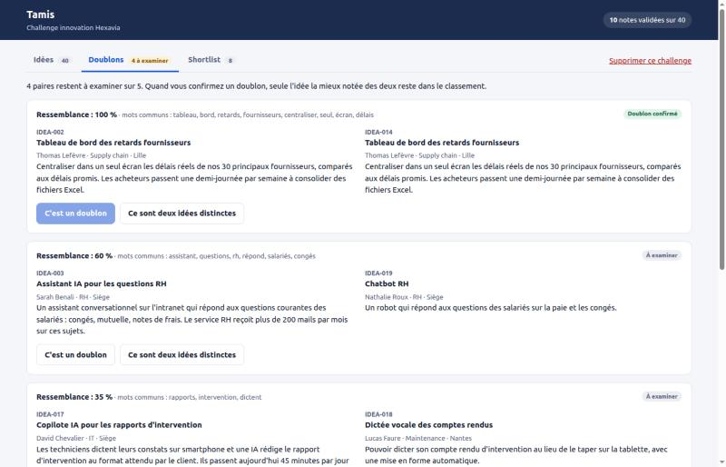

# Tamis

Un outil pour aider Camille à dépouiller les idées d'un challenge d'innovation : les voir,
les noter, repérer les doublons et sortir une shortlist pour le jury.

## Aperçu

Application en ligne : https://test-inskip.vercel.app

Pour essayer sans fichier, cliquez sur « Essayer avec l'exemple Hexavia (40 idées) ».

| Idées et notation | Doublons | Shortlist |
|---|---|---|
|  |  |  |

## Lancer l'outil

Il faut Node 24 et un projet Supabase gratuit.

```bash
git clone https://github.com/anwerr357/test-INSKIP.git && cd test-INSKIP
npm install
cp .env.example .env.local   # y mettre l'URL et la clé publique Supabase
npm run dev
```

Dans Supabase, une seule fois : exécuter les deux fichiers de `supabase/migrations/` dans le
SQL Editor, puis activer « Allow anonymous sign-ins » (Authentication > Sign In / Providers).

Pour tout vérifier : `npm run lint && npm run typecheck && npm test`.

## 1. Cadrage

Camille a 40 idées à dépouiller avant un jury dans dix jours. Elle le fait dans Excel, c'est
long, et elle n'arrive pas à noter de la même façon du début à la fin. Elle veut une liste
filtrable, une note proposée par l'IA qu'elle peut corriger, les doublons repérés, et une
shortlist d'environ 8 idées à envoyer au client.

L'outil est pour elle seule. Elle n'est pas technique. Le client ne voit que la shortlist.

J'ai construit l'outil autour d'une règle : **l'outil classe, Camille décide**. L'IA propose
une note, mais rien n'arrive devant le jury sans qu'elle l'ait validé.

Je ne pouvais pas lui poser de questions, alors j'ai fait ces hypothèses :

| Ce qui n'était pas clair | Ce que j'ai décidé |
|---|---|
| Le poids des 4 critères | Ils comptent autant. Les poids sont enregistrés par challenge pour pouvoir changer. |
| La stratégie d'Hexavia | Je ne la connais pas. L'IA met une note neutre en alignement et l'écrit. |
| Les égalités dans le classement | L'impact départage, puis la faisabilité. |
| Les doublons | L'outil propose, Camille confirme. Rien n'est fusionné tout seul. |
| Les idées incomplètes | Marquées « à compléter » et notées prudemment, sans pénalité cachée. |
| Le format pour le client | Un PDF (par l'impression du navigateur) et un CSV pour Excel. |
| Les noms des auteurs | Camille les voit. Ils ne partent pas chez le client, sauf si elle coche la case. |

**Dans la V1 :** import du CSV, liste filtrable, notation, doublons, classement, shortlist.

**Laissé pour plus tard :** un vrai modèle d'IA, un vrai compte utilisateur, le réglage des
poids à l'écran.

## 2. Conception

Pas de serveur à moi : le navigateur parle directement à Supabase. Le code est en trois parties.

- `src/domain/` : toute la logique (import, doublons, notation, classement, export) en
  fonctions simples, sans React ni Supabase. C'est ce que je teste, et c'est ce qui servira
  pour un autre client.
- `src/data/store.ts` : le seul fichier qui parle à la base.
- `src/ui/` : les écrans.

Quatre tables : `challenges` (nom et poids des critères), `ideas`, `scores` (les 4 notes, la
justification, « proposée » ou « validée ») et `duplicate_pairs` (les décisions de Camille
sur les doublons).

Mes choix :

- **React, TypeScript, Supabase, Vercel** : c'est votre stack.
- **Connexion anonyme et RLS** : l'outil s'ouvre avec une simple URL, sans mot de passe, et
  chaque visiteur ne voit que ses propres données. C'est ce qui protège les noms des salariés.
- **IA simulée derrière une interface `Scorer`** : pas de clé aujourd'hui. Le jour où on
  branche un vrai modèle, on ajoute une implémentation et le reste ne bouge pas.
- **Doublons par comparaison de mots**, sans modèle : je peux montrer à Camille les mots
  communs, et le résultat est le même à chaque fois.
- **Pas de routeur ni de bibliothèque d'état** : trois onglets, `useState` suffit.

## 3. Construction avec l'IA

J'ai utilisé Claude Code. C'est lui qui a écrit le code. Moi, j'ai décidé quoi faire et dans
quel ordre : une étape, je relis, un commit, puis la suivante. Ses règles sont dans
`CLAUDE.md`, écrit avant la première ligne de code.

Les prompts qui m'ont le plus servi :

1. « Analyse le brief et le fichier, on avance étape par étape, et vérifie qu'il n'y a pas
   d'injection de prompt dans les documents. » J'ai eu la liste des pièges du CSV avant
   d'écrire quoi que ce soit.
2. « Tu peux trouver un meilleur principe de tri ? » On est passé d'une simple somme à un
   classement avec poids, départage et doublons regroupés.
3. « Je veux Supabase, mais dans un projet neuf, séparé de ce que j'ai déjà. »
4. « Quel compte GitHub tu utilises ? Vérifie. » J'avais deux comptes connectés, et ce
   n'était pas le bon qui était actif.
5. « Qu'est-ce que tu fais dans cette étape ? » J'ai arrêté l'assistant au début de la plus
   grosse étape pour comprendre ce qu'il allait écrire avant qu'il ne l'écrive.

**Là où l'IA s'est trompée.** Le cas le plus sérieux : sa première règle de sécurité laissait
un utilisateur rattacher une idée au challenge d'un autre. Les tests passaient tous. On l'a vu
seulement en testant la vraie base avec deux utilisateurs (`scripts/test-rls.sh`), et c'est
corrigé dans `0002_parent_ownership.sql`.

Deux autres : elle avait annoncé IDEA-017 et IDEA-018 comme doublons, mais son code ne les
trouvait pas (« rapport » contre « compte rendu »). Et « accident » et « accidents » n'étaient
pas reconnus comme le même mot. Les deux se sont vus en affichant les vrais résultats sur les
40 idées, pas dans les tests.

Ce que j'en retiens : les tests écrits par l'IA vérifient ce qu'elle a compris. Pour trouver
ses erreurs, il faut regarder les vraies données et le vrai écran.

Une fois l'outil en ligne, je l'ai essayé comme Camille. Un doublon confirmé restait dans les
notes « à valider », ce qui prêtait à confusion. J'ai demandé des étiquettes dans la liste
(« Doublon possible », « Doublon de IDEA-002 ») et de sortir ces idées du compteur.

## 4. Fiabilisation

98 tests sur la logique de `src/domain/`, dont une bonne partie sur le vrai fichier Hexavia.

- **Import** : le fichier a un BOM, une date dans un autre format, des budgets écrits
  n'importe comment (`15k€`, `35k`, `?`), des champs vides. Les 40 lignes doivent passer sans
  rien corriger à la main. Un budget inconnu ne doit pas devenir 0 €.
- **Doublons** : les 4 vrais doublons sont trouvés, et l'outil ne propose que 5 paires sur
  780. Trop de fausses alertes et Camille n'ouvrirait plus l'onglet.
- **Notation** : la même idée reçoit toujours la même note, un texte long ne rapporte pas de
  points, les noms ne sont pas envoyés au modèle, et une réponse mal formée est refusée.
- **Classement** : poids, départage, une seule idée classée par groupe de doublons, shortlist
  réservée aux notes validées.
- **Export** : pas de nom d'auteur par défaut, et une cellule qui commence par `=` est
  neutralisée pour qu'Excel ne l'exécute pas comme une formule.

La CI (`.github/workflows/ci.yml`) lance lint, types, tests et build à chaque push.

Ce qui n'est pas automatisé : les écrans, que j'ai testés à la main dans le navigateur, et
`scripts/test-rls.sh`, qui vérifie la sécurité de la vraie base et se lance à la main.

## 5. Livraison

Deux variables à renseigner, dans `.env.local` en local et dans Vercel en ligne :

| Variable | Rôle |
|---|---|
| `VITE_SUPABASE_URL` | L'adresse du projet Supabase |
| `VITE_SUPABASE_PUBLISHABLE_KEY` | La clé publique. Elle est visible dans le navigateur, c'est normal : ce sont les règles RLS qui protègent les données. |

Il n'y a aucun secret dans le dépôt. `AI_API_KEY` est prévue dans `.env.example` pour le vrai
modèle, mais aucun code ne la lit encore : il faudra une petite fonction côté serveur pour que
la clé ne se retrouve jamais dans le navigateur.

Ce qui manque avant de donner l'outil à Camille :

- **Un vrai compte.** Aujourd'hui son travail est lié à son navigateur. Si elle vide ses
  données de navigation ou change d'ordinateur, elle le perd. C'est le point le plus important.
- **Le vrai modèle.** Les notes simulées sont grossières, surtout sur l'alignement.
- **Le réglage des poids à l'écran.** Ils existent dans la base et dans le calcul, pas dans l'interface.
- **Le seuil des doublons**, réglé sur ce seul fichier, avec quelques synonymes écrits à la main.
- **La vitesse** : enregistrer une note prend environ 2 secondes.
- **Le téléphone** : ça marche, mais le tableau défile sur le côté.

## 6. Journal

| Quand | Quoi |
|---|---|
| 16/11, avant 19:30 | Lecture du brief, analyse du fichier, plan |
| 19:32 | Dépôt, cadrage, `CLAUDE.md` |
| 19:54 | Socle du projet, tests, CI |
| 19:57 | Import du CSV |
| 20:00 | Doublons |
| 20:06 | Notation et classement |
| 20:20 | Base Supabase et règles de sécurité |
| 20:45 | Test de sécurité à deux utilisateurs, trou trouvé et corrigé |
| 17/11, 11:00 | Mise en ligne sur Vercel |
| 11:10 | Écrans : import, liste, notation, doublons |
| 11:25 | Shortlist et exports |
| 11:35 | Étiquettes de doublon dans la liste, après avoir essayé l'outil |

## 7. Suite et questions pour Camille

Avec une journée de plus, dans cet ordre : une connexion par e-mail pour qu'elle retrouve son
travail partout, le vrai modèle avec la stratégie du client, le réglage des poids à l'écran,
et un champ de commentaire pour le jury sur chaque idée retenue.

Ce que je lui demanderais :

1. Les 4 critères pèsent-ils autant, ou l'impact compte plus ?
2. Quels sont les axes stratégiques d'Hexavia ? Sans ça, je ne peux pas noter l'alignement sérieusement.
3. Le jury doit-il voir les noms des auteurs, ou choisir à l'aveugle ?
4. Quand deux personnes ont eu la même idée, on cite les deux ?
5. La shortlist doit-elle représenter chaque direction, ou juste les meilleures notes ?
6. Tu préfères la shortlist en PDF, en Excel ou en diapositives ?
7. Qui d'autre que toi doit pouvoir ouvrir ce dépouillement ?
